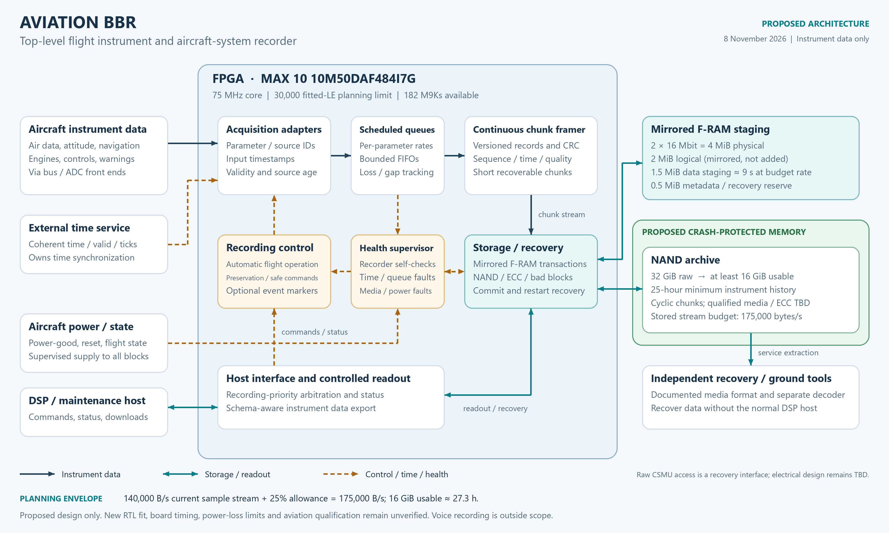

# Aviation BBR business proposal

[Documentation index](README.md) | [Technical design](Aviation_BBR_design.md)

**Date:** 8 November 2026  
**Status:** Draft commercial proposal for customer discovery and development planning  
**Currency:** All amounts are US dollars (USD), excluding taxes, shipping and installation.

## 1. Proposal

Develop Aviation BBR into a configurable flight instrument data recorder for aircraft development, research and experimental applications. Start with a non-certified engineering product targeting a **$3,500 direct selling price per unit**, supported by separately priced integration services. Pursue a crash-protected, approved flight data recorder only after customer demand, technical feasibility and a funded approval route have been established.

The immediate commercial objective is to secure three development partners, agree their recording requirements and obtain paid pilot commitments before committing to production hardware.

This is a proposal for a product under development. The public repository currently contains a design study and architecture diagrams; it does not contain an implemented or validated aviation recorder. The private baseline BBR is a potential source of reusable engineering, not evidence that the aviation product is complete. No customers, orders, supplier quotations or investment commitments are established by this document.

## 2. Customer problem and proposed value

Aircraft developers and research teams need to capture numerical instrument, sensor and aircraft-system data, reconstruct test events and identify missing or corrupted measurements. Configuring interfaces, recovering data after power interruptions and converting raw recordings into usable engineering data can consume significant integration effort.

Aviation BBR would offer a documented recording path with continuous capture, source identity, timestamps, explicit data-quality information and independent readout. The intended value is dependable, interpretable data and a manageable integration effort. Customer interviews must establish whether these benefits justify a dedicated recorder instead of existing avionics logging or a general-purpose data acquisition system.

Proposed capabilities follow the [technical design](Aviation_BBR_design.md):

- Continuous instrument recording with a provisional 25-hour retention target.
- FPGA acquisition and buffering with defined timing and source-validity behavior.
- Mirrored F-RAM staging and a NAND archive, subject to component and controller validation.
- Recoverable recording chunks and measured power-loss behavior.
- A documented data format, download utility and engineering-data export.

These are development targets. Interface count, sampling performance, usable storage, recoverable tail loss and environmental limits must be specified and verified before being included as guaranteed sales specifications. Voice, image and video recording are outside the current design scope. Crash protection is a separate future development activity.

## 3. Initial customers and positioning

| Customer segment | Proposed use | Commercial approach |
|---|---|---|
| Aircraft and avionics development teams | Bench integration and instrument-data capture during development | Paid evaluation followed by a defined pilot |
| Universities and aerospace research groups | Repeatable data collection and engineering analysis | Evaluation kit with documented interfaces and export tools |
| Experimental aircraft developers | Supplemental instrument logging where the installation and use are permitted | Limited pilot with agreed installation responsibilities |
| Equipment manufacturers | Recorder integration into their own development platforms | Hardware supply plus separately scoped engineering services |

Begin with bench and research use. Any airborne pilot must establish the applicable installation and operating permissions before flight. The initial product is not offered as a replacement for a required approved FDR.

The proposed differentiation is configurable acquisition, explicit quality and recovery behavior, and accessible engineering readout. FPGA implementation is an enabling technology; it is not, by itself, a reason for customers to pay a premium.

No total market size or obtainable market share is claimed. Interview evidence and qualified opportunities should precede a market forecast.

## 4. Market price references

Public references provide context for pricing, but are not equivalent product comparisons:

| Reference | Published price context | Limitation |
|---|---|---|
| FAA Investigative Technologies Aviation Rulemaking Committee, final report dated 29 August 2025, section VI.B, printed page 21 | Approximately $3,000 for a light recording unit to $60,000 for an ED-112-compliant FDR | Broad hardware range; aircraft modification and installation are excluded. [Report](https://www.faa.gov/media/105721) |
| Air Power, part 2100-2045-23, checked 8 November 2026 | Listed price $38,244; refundable core charge $10,000; total before core return $48,244 | Listing states new condition and backorder. Price and terms require confirmation; this is not an Aviation BBR quotation. [Listing](https://www.airpowerinc.com/2100-2045-23) |

The $3,500 initial target is a pricing hypothesis to test with prospective customers. It is not derived from verified BBR manufacturing costs or demonstrated willingness to pay.

## 5. Product and revenue model

| Offering | Proposed price | Proposed scope and conditions |
|---|---|---|
| Engineering evaluation kit | $1,500-3,000 per kit | Bench hardware, example data, basic download tools and limited evaluation support; configuration may be reduced from the enclosed product |
| Standard development recorder | **$3,500 target per unit**; planning range $3,000-6,000 | Enclosed and tested non-certified recorder, documented standard interfaces, readout utility and defined support |
| Customer integration | Separate statement of work | Source interfaces, parameter mapping, adapters, test procedures and acceptance evidence |
| Extended support | Separately quoted annual agreement | Defined response times, maintenance releases and compatibility assistance |
| Future approved FDR | $25,000-45,000 per unit as an exploratory target | Subject to approval route, crash-survival evidence, production costs, market validation and partner support; not currently available |

Standard hardware pricing excludes sensors, aircraft wiring, installation, custom interfaces, qualification, approval work and bespoke analysis. The standard interface set and included support allowance must be fixed before accepting production orders.

Use direct sales for initial pilots. Distributor pricing needs a separate model because channel discounts reduce realized revenue. Do not promise volume discounts until manufacturing yield, support load and procurement costs are measured.

## 6. Illustrative unit economics

The following is a **cost allowance**, not a supplier-backed BOM. It assumes direct sales of the standard non-certified recorder at $3,500. The $1,400 total is a cost ceiling to test during design and procurement.

| Recurring cost category | Target allowance per unit |
|---|---:|
| Electronics, PCB, FPGA, memory and standard interface components | $650 |
| Enclosure, connectors and mounting hardware | $150 |
| Assembly and production testing | $200 |
| Yield loss, procurement and inbound freight allowance | $150 |
| Warranty and repair reserve | $100 |
| Included customer support allowance | $150 |
| **Total recurring cost allowance** | **$1,400** |

At this allowance, gross contribution is **$2,100 per unit**, or **60% of revenue**. This simplified commercial model is not an accounting policy. It excludes fixed development, tools, salaries outside allocated production/support, sales, administration, insurance, finance costs and future approval expenditure.

| Direct selling price | Recurring unit cost | Contribution per unit | Contribution margin |
|---|---:|---:|---:|
| $3,000 | $1,400 | $1,600 | 53.3% |
| $3,500 | $1,400 | $2,100 | 60.0% |
| $3,500 | $2,000 | $1,500 | 42.9% |
| $4,500 | $2,000 | $2,500 | 55.6% |

If the required aircraft interfaces or storage implementation make the cost ceiling unrealistic, reduce the standard configuration, increase price or stop the product before production commitments.

## 7. Sales scenarios and development funding

These scenarios illustrate scale at $3,500 revenue and $1,400 recurring cost per unit. They are not an annual forecast, sales pipeline or evidence of demand. Integration and support-contract revenue are excluded because delivery effort and margins are not yet estimated.

| Units sold in a planning period | Hardware revenue | Recurring costs | Contribution before fixed costs |
|---|---:|---:|---:|
| 25 | $87,500 | $35,000 | $52,500 |
| 100 | $350,000 | $140,000 | $210,000 |
| 250 | $875,000 | $350,000 | $525,000 |

For illustration, recovering **$300,000 of fixed development expenditure alone** would require **143 units** at $2,100 contribution each. This does not establish company break-even: operating overhead, selling costs, cash timing and further development must also be covered. The $300,000 figure is an example, not an engineering budget or funding request.

Before seeking investment or committing delivery dates, prepare a bottom-up budget for engineering effort, prototype hardware, test equipment, third-party testing, tooling, software, insurance and working capital. Estimate cash required to buy and build pilot units before customer payments arrive. Include schedule and cost contingency based on the identified risks. Price and fund crash protection and aviation approval separately.

Prefer paid discovery and milestone-based development contracts for customer-specific work. Any deposits should be tied to written deliverables, acceptance criteria, delivery assumptions and cancellation terms. Customer commitments must not be represented as guaranteed production revenue before their conditions are satisfied.

## 8. Development stages and release gates

Timing below is an initial planning assumption measured from a funded project start with an available engineering team. Team capacity, procurement and requirements review must establish the actual schedule.

| Stage | Indicative timing | Required evidence before proceeding |
|---|---|---|
| Customer discovery and requirements | Months 0-2 | At least 10 customer interviews; three qualified development partners; agreed interfaces and acceptance criteria; willingness-to-pay evidence |
| Architecture and bench demonstrator | Months 2-5 | Versioned format, acquisition model, readout prototype and initial BOM; simulation of rollover, faults and power-loss recovery |
| Integrated prototype | Months 5-9 | Prototype hardware, full-retention and cyclic-overwrite tests, measured storage behavior, timing evidence and independent decoding |
| Paid pilot and production preparation | Months 9-12 | Pilot commitments and acceptance results; verified build/test process, costed supply chain and defined support terms |
| Controlled commercial release | After pilot acceptance | Released configuration, production acceptance tests, published limitations and a funded support process |
| Approved FDR feasibility | Separate project decision | Identified aircraft/customer, approval basis, qualified partners, costed crash-survival and assurance plan, funding and commercial justification |

The initial 12-month sequence is not a delivery commitment. Do not launch against a date if recovery, retention, interface compatibility or production evidence remains incomplete.

## 9. Sales and pilot plan

Prepare a short product brief, the architecture diagram, an interface questionnaire and a demonstration using representative instrument data. Approach engineering decision makers directly and record their present logging method, integration costs, required interfaces, data-loss tolerance and purchasing process.

Select three pilot partners with similar core requirements to avoid creating three unrelated products. Agree a fixed standard configuration and quote custom adapters separately. Each pilot should demonstrate sustained recording, readable export, timestamp/quality behavior and measured recovery after interruptions against written acceptance criteria.

Measure conversion from interview to paid pilot, engineering hours per integration, recurring unit cost, production yield, support hours and pilot acceptance. Release the standard product only when customers accept its measured capabilities at a price that supports the cost model.

## 10. Intellectual property and delivery model

The public [Aviation-BBR repository](https://github.com/Ala-Ismail/Aviation-BBR) contains MIT-licensed material. The private [BBR baseline](https://github.com/Ala-Ismail/BBR) requires authorized access. Publication of this proposal does not grant access to or change the license of the private repository.

Revenue should come from delivered hardware, tested configurations, integration and support. Do not base the business case on exclusive access to material already published under MIT. Before shipping a product, establish the rights to every reused design, HDL block, software component and vendor IP, and define which deliverables will be public, private or supplied under customer contracts.

This proposal introduces no dependency on publishing private BBR source or copying its private documents into the public repository.

## 11. Main business risks

| Risk | Effect | Proposed response |
|---|---|---|
| Existing avionics logging meets customer needs | Weak willingness to pay | Validate specific unmet requirements before hardware investment |
| Too many bespoke interfaces | Integration consumes hardware margin | Publish a standard configuration; charge separately for custom engineering |
| NAND, ECC or recovery complexity | Higher cost and delayed release | Prototype the storage path early and verify interruption behavior |
| Component availability or low production yield | Cost ceiling is missed | Obtain supplier quotes and pilot-build yield data before fixing production prices |
| Buyers expect approved crash-protected recording | Product is unsuitable for the intended purchase | State product status and operating limits in quotations and specifications |
| Support and liability costs exceed allowances | Lower margin and higher cash needs | Define support scope, review insurance needs and measure pilot support effort |
| Approval programme begins before demand is proven | Capital required exceeds available funding | Make approval a separately funded, customer-backed decision |

## 12. Proposed next decision

Proceed with customer discovery and a costed bench-demonstrator plan. Retain **$3,500 per unit** as the initial standard-recorder price hypothesis and **$1,400 per unit** as the recurring-cost ceiling. Revisit both after interviews, supplier quotations and prototype testing.

The next commercial deliverables are three qualified pilot opportunities, a standard interface specification, a quoted BOM, an engineering work estimate and a staged cash budget. Those deliverables should support the decision to fund an integrated prototype. No immediate investment amount, certified-product launch date or sales forecast is approved by this draft.
